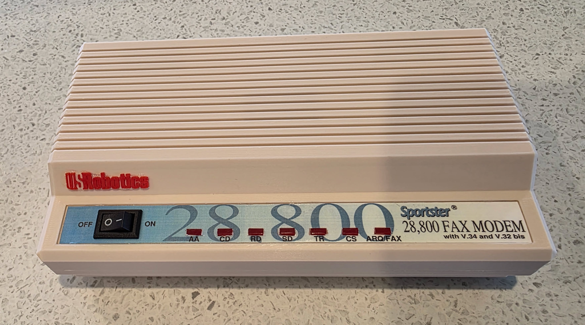
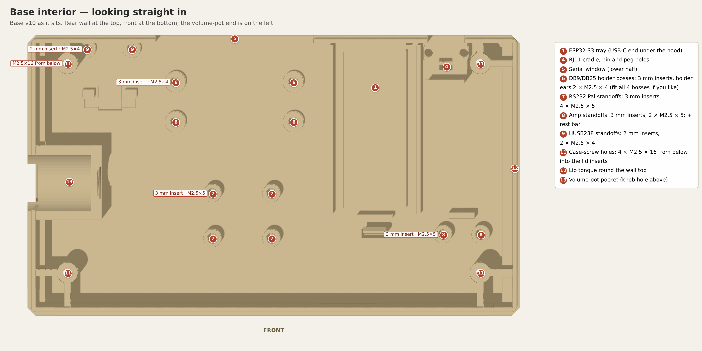
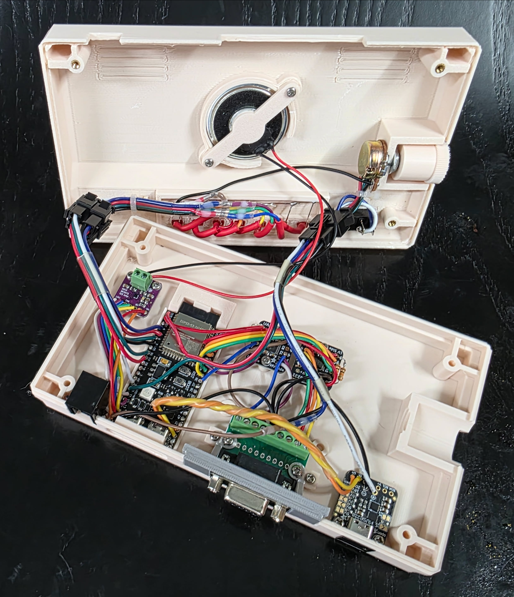
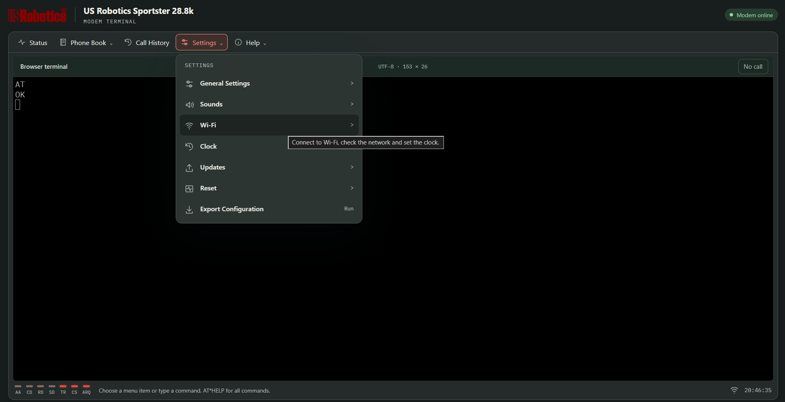

# Build a USR Wi-Fi Modem

This is an independent, unsanctioned, non-commercial hobby project: a small shrine to US Robotics and the Sportster modem range, made with affection for fellow retro computing enthusiasts. Whether you remember your first BBS connection or are discovering dial-up for the first time, you're welcome to join us in proudly respecting, recognising and reliving the important place these modems held in the BBS and dial-up Internet era of 1990s and 2000s, with a little nostalgia for every handshake.

We respectfully acknowledge US Robotics' trademarks, copyrights and other intellectual property rights in its names, logos, designs and original materials. Those rights remain with their respective owners. This tribute is neither affiliated with nor authorised, sponsored or endorsed by US Robotics.

Turn a retro computer's serial port into a connection to a Telnet BBS or the Internet, with the look, lights and sounds of a US Robotics Sportster modem.



This project puts an ESP32-S3, a small programmable board with Wi-Fi, inside a 3D-printed Sportster replica. Your computer sends familiar Hayes `AT` commands to a real RS232 modem port. The ESP32 turns a dial command into a network connection over Wi-Fi, plays the dialling and handshake sounds, then passes data between the computer and the remote service.

You can also use it from a modern computer through USB, pass that USB serial port into an emulator, or make calls from the modem's browser terminal. The electronics are assembled from small ready-made boards and wired together; there is no custom circuit board to manufacture.

The finished modem provides:

- Outgoing Telnet and raw TCP connections, and basic SSH for hobby use only, with a 64-entry phonebook.
- Incoming Telnet calls, manual answering and auto-answer.
- PPP and SLIP Internet access for computers with a suitable TCP/IP stack.
- A USB modem port and a browser interface for configuration and BBS calls.
- Seven front-panel lights, a volume knob, a speaker and recorded modem handshakes.
- Selectable Sportster identities: 14.4k, 28.8k, 33.6k and 56k.
- Guided electronics tests and serial terminal/cable diagnostics.

The network connection replaces the telephone line. The replica's telephone socket is cosmetic and has no connection to the modem electronics. Leave it disconnected from telephone wiring. The fax light indicates wifi status; fax operation is not implemented.

## Follow the build

This guide covers both **DB9 and DB25 rear sockets**. Choose whichever suits you:

| Rear socket | Why choose it? | How it is fitted |
|---|---|---|
| DB9 female | Convenient for modern use: USB-to-RS232 cables usually have a DB9 connector | Fit the DB9 terminal board and the printed insert around the socket |
| DB25 female | Matches the socket on the original Sportster modems | Mount the same DB9 terminal board farther back inside the case using the alternate mounting holes, then attach the DB9-to-DB25 adapter |

**The wiring and firmware are identical for both versions.** Only the mounting position, opening insert and adapter differ. The current build photos all show the DB9 version.

1. [Gather the parts and tools](#1-gather-the-parts-and-tools).
2. [Print the case and fittings](#2-print-the-case-and-fittings).
3. [Print and fit the front label](#3-print-and-fit-the-front-label).
4. [Prepare the case and mount the parts](#4-prepare-the-case-and-mount-the-parts).
5. [Install the firmware on the ESP32](#5-install-the-firmware-on-the-esp32).
6. [Wire the electronics](#6-wire-the-electronics).
7. [Check the build and test the hardware](#7-check-the-build-and-test-the-hardware).
8. [Join Wi-Fi and open the browser interface](#8-join-wi-fi-and-open-the-browser-interface).
9. [Connect a computer or emulator](#9-connect-a-computer-or-emulator).
10. [Make your first call](#10-make-your-first-call).
11. [Finish the case and learn the controls](#11-finish-the-case-and-learn-the-controls).
12. [Back up settings and install updates](#12-back-up-settings-and-install-updates).

Read through the wiring section before soldering. You can print the case while preparing the software, and program the ESP32 on its own before attaching any other electronics. Diagnostic commands are provided to test the electronics, once wired. You can introduce the electronics a piece at a time, or all at once.

## 1. Gather the parts and tools

### Electronics

Use the specified ESP32 board and modules if you want the printed mounts and default firmware wiring to match. In particular, **N16R8 means 16 MB of flash storage and 8 MB of PSRAM**; a board with less memory is not a direct substitute. The case was designed around the ePartners ST8002 DevKitC-1-style board, approximately 57 × 28 mm, with two USB-C sockets. The header pins were desoldered and replaced with direct wired cables. Note: Other boards sold as “DevKitC-1” may have different dimensions or pin layouts.

| Part | Quantity | What it does |
|---|---|---|
| ESP32-S3-WROOM-1 N16R8, ePartners ST8002 / matching DevKitC-1-style board | 1 | Runs the firmware, Wi-Fi and USB modem port |
| Adafruit RS232 Pal, product 5987, MAX3232E | 2 | Converts the ESP32's 3.3 V signals into real RS232 levels |
| Tech Express DB9-F-TERMINAL-NZ screw-terminal board | 1 | Gives each DB9 pin a numbered wiring terminal |
| Assmann AB468 DB9 male to DB25 female adapter | 1 for DB25 only | Plugs into the DB9 terminal board to provide the DB25 rear socket |
| Adafruit HUSB238 USB-C power board, product 5807 | 1 | Rear power socket and USB data connection; set to **5 V** |
| SW0133 SPST rocker switch | 1 | Front-panel power switch |
| Adafruit MAX98357A I2S amplifier, product 3006 | 1 | Drives the speaker from digital audio |
| Same Sky CLS0361-L152 speaker, 8 Ω, 2 W, 36 mm diameter | 1 | Dialling, ringing and handshake sounds |
| WH148 B10K, 10 kΩ linear potentiometer | 1 | Volume control |
| Jaycar ZD0230 red rectangular LED, 5 × 2 mm | 7 | Front-panel indicators |
| 10 kΩ resistors | 4 | Keep RS232 outputs in a defined state during startup |
| Insulated hookup wire, heat-shrink tubing and cable ties | As needed | Connections and insulation |
| USB-C power supply and cable | 1 | A 5 V source with at least 1 A available for the assembled unit |
| Data-capable USB cable for the ESP32's Console USB port | 1 | Programming and initial setup |
| Straight-through RS232 modem cable suitable for your computer | 1 | Connects the finished modem to the computer |

The [final electronics brief](electronics/USR%20Modem%20Electronics%20Final%20Brief.md) gives the complete netlist and board-header positions. A [PDF copy](electronics/USR%20Modem%20Electronics%20Final%20Brief.pdf), component datasheets and an [ESP32 pinmap](electronics/ESP32-S3-Pinmap.png) are also in [`electronics/`](electronics/). Refer to the printed GPIO labels on your own board before making connections.

### Case, label and fasteners

You will need cream or beige PLA for the enclosure and knob, red or black (as suits) for the logo, and black for the rear power trim. The supplied print projects also include a grey/silver DB9 insert option. A single-colour printer can make separate parts in separate print jobs.

Use M2.5 brass heat-set inserts: these are small threaded sleeves pressed into the plastic with a heated tool - a soldering iron with a fine point tip set to 220'c works well. The measurements below are **insert lengths**, not hole diameters.

| Location | Inserts |
|---|---|
| Four lid corners | 4 × M2.5, 6 mm long |
| Speaker strap mounting holes in the lid | 2 × M2.5, 4 mm long |
| Base mounting points for the serial connector holder | 2 × M2.5, 3 mm long; optionally fit all four positions |
| Two RS232 Pal modules | 4 × M2.5, 3 mm long |
| Amplifier | 2 × M2.5, 3 mm long |
| USB-C power board | 2 × M2.5, 2 mm long |
| Serial connector holder itself | 2 × M2.5, 3 mm long |

| Fixing | Screws |
|---|---|
| Base to lid | 4 × M2.5 × 16 mm, pan head |
| Speaker strap | 2 × M2.5 × 6 mm |
| DB9 terminal board to holder | 2 × M2.5 × 5 mm |
| Holder to base | 2 × M2.5 × 4 mm |
| Two RS232 Pals | 4 × M2.5 × 5 mm |
| Amplifier | 2 × M2.5 × 5 mm |
| USB-C power board | 2 × M2.5 × 4 mm |

These lengths come from the [construction drawings](case/construction/) and [fastener notes](case/construction/Screws%20and%20Inserts.txt). Check engagement with your actual inserts: a screw must hold the part without bottoming out or reaching the outside wall. Add four round **10 mm diameter × 5.75 mm** adhesive rubber feet for the base recesses.

For the label, use A4 self-adhesive paper or printable vinyl suitable for your printer, plus plain paper for a trial fit. A clear protective film is optional. You will also need a little suitable adhesive for decorative parts.

### Tools and workspace

- An FDM 3D printer, or a printing service, and slicer software. The supplied projects are for Bambu Studio; individual STL files are included for other slicers.
- A 0.4 mm nozzle for the main parts and, ideally, a 0.2 mm nozzle for the fine details.
- A temperature-controlled soldering iron, solder, cutters, wire strippers and tweezers.
- A heat-set insert tip or suitable heated insertion tool, small screwdrivers and a craft knife.
- A multimeter for voltage, continuity and polarity checks.
- A Windows PC with USB, Internet access and VS Code for the firmware instructions below.
- A 2.4 GHz Wi-Fi network that the modem can join.

Allow separate sessions for printing, fitting, soldering and commissioning. You should be comfortable making insulated solder joints and checking a circuit with a multimeter before connecting it to a retro computer.

## 2. Print the case and fittings

There are two prepared print projects:

| Project | Saved settings | Contents |
|---|---|---|
| [0.4mm Main Print.3mf](case/0.4mm%20Main%20Print.3mf) | Bambu P1S, PLA, 0.4 mm nozzle, 0.12 mm layers, 3 walls, 15% infill, automatic tree supports enabled | Enclosure, serial holder/inserts, speaker strap, ESP32 brace and USB blanks |
| [0.2mm Fine Parts.3mf](case/0.2mm%20Fine%20Parts.3mf) | Bambu P1S, PLA, 0.2 mm nozzle, 0.06 mm layers, 4 walls, 40% infill, supports disabled | Two knob styles, logo and black power trim |

Some small parts have their own settings, including solid infill. Keep those overrides when using the projects. Before printing, select your actual printer, nozzle, plate and filament profiles, then slice again and inspect the preview. These are saved settings for the supplied projects, rather than a guarantee for every printer.

If you use another slicer, import the individual models from [`case/parts/`](case/parts/) at **100% scale**, in millimetres. Start with the settings above and use the construction drawings to check orientation and mounting details. Test a small holder or knob before committing to the full case.

Print these parts for either version:

| Model in `case/parts/` | Purpose |
|---|---|
| `modem-base.stl` and `modem-lid.stl` | Main enclosure |
| `db9-holder-v3b-text.stl` | Holds the DB9 terminal board, including when it carries the DB25 adapter |
| `speaker-strap-bar.stl` | Retains the speaker in the lid |
| `s3-latch-brace.stl` | Retains the ESP32 in its tray; a `s3-latch-brace-v6.stl` alternative is also supplied for fit checking |
| `power-panel-black.stl` | Black trim around the rear USB-C socket |
| `usb-blank-full.stl` or `usb-blank-half.stl` | Covers both onboard USB sockets, or leaves one accessible |
| `voldial-hub-plus7.1-bore6.1-faceA.stl` or `voldial-hub-plus7.1-bore6.1-faceC.stl` | Choose one volume knob style; both have a nominal 6.1 mm bore |
| `usr-logo.stl` | Decorative front logo |

For a **DB9 rear socket**, also print `db9-insert-v4.stl` to fill the wider serial opening. For **DB25**, leave out that insert and use the DB9-to-DB25 adapter instead. The main print project contains alternative inserts; you only need the one you choose. The [extra-parts drawing](case/construction/extra-parts.png) explains the fittings, though some filenames in that drawing predate the current STLs.

Remove supports and loose strands carefully. Check the lid meets the base, the LEDs and switch fit their openings, the knob fits its shaft, and the boards sit in their mounts. Correct the fit before installing inserts or soldering. Keep the original scale: resizing the enclosure also moves its mounting holes and connector openings.

If you need to modify the case and you aren't familiar with 3D modelling softwaree, AI is you best option. This was how I modified luizpacheco's design.

Credit: This wouldn't have been possible without the excellent RetroExternalModem design by luizpacheco on Thingiverse: https://www.thingiverse.com/thing:7063155.

## 3. Print and fit the front label

The label folder contains designs for all four modem identities. Choose the appearance you prefer; you will set the firmware to match later.

1. Open [USRobotics_All_Speeds_A4_STL_Print.pdf](case/labels/USRobotics_All_Speeds_A4_STL_Print.pdf). This sheet aligns the switch and LED cutouts to the printed case and includes two copies of each design.
2. Print a paper test on A4 at **100% / Actual size**. Turn off “Fit to page” and similar scaling options.
3. Measure the **100 mm scale-check line** at the bottom of the sheet. It should measure 100 mm. Cut out your chosen label and hold it against the case, checking the switch opening and all seven LED positions.
4. Once the paper test fits, print on your chosen adhesive stock. Let the ink or toner settle as required by that material. You may wish to laminate the label for extra protection.
5. Cut the outside edge with a craft knife using a ruler as a straight edge.
6. Clean the front recess, let it dry, and apply the label gradually from one end. Smooth it down without stretching it. It is easier to do this while the lid is empty.
7. Once the adhesive is dry, cut the switch/LED openings with a sharp knife on a cutting mat. The switch and LED holes make the cutting easier.

The [label folder](case/labels/) also contains individual PNGs, a high-resolution STL-aligned A4 PNG and an alternative A4 print sheet. Prefer the STL-aligned PDF for this enclosure: image editors and printer software can interpret PNG scale differently.

## 4. Prepare the case and mount the parts

Use the [base plan](case/construction/base-inside-plan.png) and [lid plan](case/construction/lid-inside-plan.png) to identify each mount. Each drawing looks into that half of the enclosure, so left and right change when you turn the lid over.



1. Fit the heat-set inserts before mounting electronics. Use the insert and filament suppliers' temperature guidance, press each insert squarely into its hole, and stop at the intended surface. Let it cool before fitting a screw. Support the plastic around the hole and avoid pushing through the thin case wall.
2. Position the ESP32 in its tray with its USB sockets facing the rear opening. Check the chosen latch brace holds it without bending the board. Leave the **Console USB / UART** socket accessible for programming.
3. Mount the two RS232 Pals, amplifier and USB-C power board at the positions shown in the drawing. Check that solder joints cannot touch neighbouring hardware.
4. Fit the DB9 terminal board to its printed holder. For **DB9**, use the mounting points that bring its socket to the rear opening, and fit the printed DB9 insert around it. For **DB25**, mount the same board farther back inside the case using the alternate mounting holes, then plug the AB468 DB9-to-DB25 adapter into it. The adapter's DB25 socket sits at the rear opening. Check connector alignment with the lid in place before tightening. No wiring or firmware changes are needed.
5. Seat the speaker in the lid pocket and retain it with the strap and two M2.5 × 6 mm screws. The strap bears lightly on the magnet; avoid overtightening or touching the speaker cone. If you are concerned about speaker movement, consider applying a small piece of double-sided tape to the centre part of the speaker strap.
6. Fit the volume pot and chosen knob. The knob should turn freely throughout the pot's travel without rubbing the case. Fit the switch and seven LEDs through the labelled front panel, noting each LED's polarity before trimming its legs.
7. Fit the rear power trim. Leave the USB blank removable so you can reach the maintenance socket later. Any RJ11 telephone socket fitted for appearance stays unwired.

The boards may need to come out again for soldering. At this stage, the aim is to establish the fit and wire lengths. Leave enough slack between base and lid to open the case for maintenance.



All current build photos, including the [rear view](screenshots/Back.jpeg), show the **DB9 version**. Use them as placement examples and follow the mounting instructions above if you choose DB25. The wiring tables below apply to both versions.

## 5. Install the firmware on the ESP32

**Firmware** is the program stored on the ESP32. This project also stores the sounds and browser files in a separate area called **LittleFS**. A complete first installation needs both uploads.

### Set up the project on your PC

1. Install Git for Windows and VS Code, then install **PlatformIO IDE** from VS Code's Extensions view.
2. Install a recent GCC compiler with C++26 support for the PC tests. The project's CI uses GCC 14. The documented Windows option is WinLibs; from PowerShell you can install it with:

   ```powershell
   winget install BrechtSanders.WinLibs.POSIX.UCRT.LLVM
   ```

   Open a new terminal afterwards and check that both `gcc --version` and `g++ --version` work. If you use MSYS2 instead, install `mingw-w64-ucrt-x86_64-gcc` and add `C:\msys64\ucrt64\bin` to your user Path.

3. Clone the project into a convenient folder:

   ```powershell
   git clone https://github.com/jedney/esp32-usr-modem.git
   cd esp32-usr-modem
   ```

4. Open that folder in VS Code, trust the project when prompted, and let PlatformIO finish its setup. The repository's access permissions still apply when cloning or downloading releases.
5. Use **Terminal → Run Task…** for the named tasks below. If you prefer commands, open a **PlatformIO terminal** and run them from the project root; `pio` may not be on the Path in an ordinary PowerShell window.

PlatformIO downloads the pinned ESP32 tools and libraries on the first build. You do not need to install an Arduino IDE or select a board package yourself. Keep the defaults in `platformio.ini` and `.env.example` for the specified hardware. Node.js and the additional Python test packages are only needed for development checks described later.

### Find the correct USB socket

The ESP32 board has two USB sockets with different jobs. Looking at its USB end, the build brief identifies **Console USB on the right** and **Serial USB on the left**. Confirm the labels and pinmap for your board.

| Socket | Use |
|---|---|
| Onboard **Console USB**, often labelled **UART** | Initial flashing and maintenance, through a USB-to-serial chip; console speed is always 115200 |
| Onboard **Serial USB**, often labelled **USB** | Native USB modem connection on GPIO19/20 |
| Rear case USB-C, on the HUSB238 board | Power and the same native USB modem connection, once wired |

Use **Console USB / UART** for these installation steps. On Windows it should appear in Device Manager under **Ports (COM & LPT)**, commonly as a CH340/CH34x serial device. Note its COM number. Use a data-capable cable; install the USB-serial chip manufacturer's driver if Windows has not recognised it.

The ESP32 USB ports are hidden behind a blanking plate where the original modem would have had DIP switches. These should not normally be needed after the initial firmware flash.

### Build and upload

1. With the ESP32 still unwired, connect its Console USB socket to the PC.
2. Run **Modem: build firmware**:

   ```powershell
   pio run -e s3
   ```

3. Run **Modem: upload over USB (tests first)**:

   ```powershell
   pio run -e s3 -t upload
   ```

   The PC unit tests run automatically before an upload; a failed test stops it. Fix compiler or test errors before continuing. If more than one serial device is connected, add your port, for example `--upload-port COM5`. If flashing stops at “Connecting…”, hold **BOOT**, tap **RST**, release **BOOT**, then retry.

4. Run **Modem: upload sounds and web files (LittleFS)**:

   ```powershell
   pio run -e s3 -t uploadfs
   ```

   This step is required for the handshake recordings and browser interface. Repeat it whenever you want to install changed sound or web files. Add `--upload-port COM5` here too if needed, substituting your own COM number.

5. Run **Modem: USB console (115200)**, or open your terminal program on the Console USB COM port at **115200 baud, 8 data bits, no parity, 1 stop bit, no flow control**:

   ```powershell
   pio device monitor -e s3
   ```

   Add `--port COM5` if you need to select the port explicitly.

6. Tap RST if you missed the startup banner. Record the generated **device password** somewhere private. It is the password for the browser, network console and Wi-Fi updates; the browser username is `admin`. The boot banner shows it until its first successful use or a password change.
7. Type `AT` and press Enter. The reply should be `OK`. Then close the console and unplug the board before wiring it.

Only one program can open a COM port at a time. Close the serial monitor before uploading again; PlatformIO's monitor exits with Ctrl-]. Keep this maintenance cable available throughout commissioning.

## 6. Wire the electronics

Work with **all USB cables and power disconnected**. Solder each connection, insulate exposed joints, and check it against the tables before moving to the next group. The final build brief describes direct soldered wiring, with screw terminals at the DB9 board; removable connectors can be added if you keep the same electrical connections.

GPIO numbers name the ESP32's programmable pins; they are not physical header positions. In the brief, `L1` means the first pin on the left header, counted from the antenna end with the board viewed from above. Use its [header tables](electronics/USR%20Modem%20Electronics%20Final%20Brief.md#4-esp32-s3-pinout-a1) alongside the GPIO labels.

At a high level, the connections are:

```text
Retro computer -- RS232 -- two RS232 Pals -- ESP32-S3 -- Wi-Fi -- BBS / Internet
                                              |
PC / emulator -- rear USB-C data ---------------+
                                              |
                              LEDs, volume pot and I2S speaker amplifier

Rear USB-C 5 V -- power switch -- ESP32 and amplifier
```

### Power and rear USB

First inspect the HUSB238 voltage jumpers: **5 V must be selected, with every higher-voltage jumper open**. Leave its SDA and SCL pins unconnected. The [manufacturer's pinout guide](https://learn.adafruit.com/adafruit-husb238-usb-type-c-power-delivery-breakout/pinouts) explains the jumpers and data pins.

| From | To |
|---|---|
| HUSB238 terminal `+` | One terminal of the front SPST switch |
| Other switch terminal | ESP32 `5V` and amplifier `Vin`; this is the switched 5 V rail |
| HUSB238 terminal `−` / `GND` | ESP32 `GND` and the common ground wiring |
| ESP32 `3V3` | Both RS232 Pals' `VIN`, the four 10 kΩ pull-ups, and the pot's clockwise end |
| HUSB238 `D+` | ESP32 GPIO20 |
| HUSB238 `D−` | ESP32 GPIO19 |

Connect the ground pins of both RS232 Pals and the amplifier to common ground. The pot's ground end, LED cathodes and DB9 terminal 5 also join this ground. Take the amplifier's 5 V branch from the power-board end of the switched rail, as in the final brief.

Keep the two USB data wires short and routed together. The rear socket and the ESP32's own native Serial USB socket share these data lines: **connect only one computer to them at a time**.

Use a supply and cable that can provide the assembled unit's approximately 1 A peak demand. A PC port, particularly USB-A, may not supply enough current for loud audio. Higher USB-C voltage is unnecessary and would damage this build. The onboard USB sockets can power the ESP32 even when the front switch is off, so unplug every cable before changing wiring.

### RS232 conversion and connector

The port is wired as **DCE**, the modem side of a serial connection. RXD and TXD below are named from the computer's point of view: RXD is data going **to** the computer, and TXD comes **from** it.

Wire the DB9 terminal board exactly the same way for either rear socket. For DB25, the plug-in adapter provides the pin conversion shown in the table; no rewiring or different firmware is required.

Call the first RS232 Pal **U1**, and the second **U2**. Each has an **LV** side for the ESP32's low-voltage signals and an **HV** side for the RS232 connector. They have matching T1/R1/T2/R2 labels on both sides, so check which side you are soldering. The [RS232 Pal pinout](https://learn.adafruit.com/adafruit-rs232-pal/pinouts) shows the distinction.

| ESP32 connection | Pal connection on LV side | Pal connection on HV side | DB9 terminal | DB25 pin through adapter | Signal at modem |
|---|---|---|---|---|---|
| GPIO1 | U1 T1 | U1 T1 | 2 | 3 | RXD, out to computer |
| GPIO2 | U1 R1 | U1 R1 | 3 | 2 | TXD, in from computer |
| GPIO39 | U1 T2 | U1 T2 | 1 | 8 | DCD, carrier indication out |
| GPIO40 | U1 R2 | U1 R2 | 4 | 20 | DTR, computer ready in |
| GPIO42 | U2 T1 | U2 T1 | 8 | 5 | CTS, permission to send out |
| GPIO41 | U2 R1 | U2 R1 | 7 | 4 | RTS, computer ready to receive in |
| GPIO38 | U2 T2 | U2 T2 | 9 | 22 | RI, incoming-ring indication out |

Finish the RS232 wiring as follows:

1. Connect both modules' **VIN to 3.3 V** and **GND to common ground**.
2. Connect DB9 terminal **5 to common ground**. Terminal numbers on the specified board correspond to DB9 pin numbers.
3. Connect **U2 V+ directly to DB9 terminal 6**, giving DSR on DB25 pin 6. This charge-pump output holds DSR asserted; it does not go to an ESP32 GPIO.
4. Fit one **10 kΩ pull-up to 3.3 V** at each LV driver input: U1 T1, U1 T2, U2 T1 and U2 T2. These four resistors keep the outputs stable while the ESP32 starts or is being programmed.
5. Leave U1 V+, both modules' **V−**, and both sides of U2's unused R2 channel unconnected.
6. For DB25, plug the AB468 DB9M–DB25F adapter into the terminal board. Check continuity against the DB9-to-DB25 column above: the adapter must preserve the standard serial signal mapping, without a null-modem crossover.

**V− is a generated negative supply, not ground.** Never join it to GND. Keep all RS232-side wiring away from the ESP32 GPIOs; the Pals provide the required voltage conversion. The firmware already handles the modules' signal inversion.

Only DB25 pins **2–8, 20 and 22** are used. Leave every other pin unconnected. This matters particularly on an Amiga, whose serial connector includes supply voltages on other pins. Check connector pin numbers carefully: the mating face and solder-side views are mirror images.

### Speaker and amplifier

I2S is the digital audio link from the ESP32 to the amplifier. Wire it as follows:

| Amplifier pin | Connection |
|---|---|
| `Vin` | Switched 5 V rail |
| `GND` | Common ground |
| `LRC` | ESP32 GPIO11 |
| `BCLK` | ESP32 GPIO12 |
| `DIN` | ESP32 GPIO13 |
| `SD` | ESP32 GPIO14; the firmware switches the amplifier on and off |
| `GAIN` | Leave unconnected, selecting 9 dB gain |
| Speaker `+` and `−` | The two speaker terminals |

**Neither speaker wire goes to ground.** The amplifier drives both terminals; see the [MAX98357A pinout guide](https://learn.adafruit.com/adafruit-max98357-i2s-class-d-mono-amp/pinouts). Keep I2S leads short and away from the RS232 wiring. Use the specified 8 Ω, 2 W speaker: the firmware allows full amplifier output and has no extra volume cap for a smaller speaker.

### LEDs and volume control

Each LED lights when its GPIO is high. Connect its anode, the positive leg, directly to the assigned GPIO, and its cathode to common ground. Identify polarity before trimming the legs; use the component datasheet or a multimeter's diode-test mode if needed.

| Front label, left to right | AA | CD | RD | SD | TR | CS | ARQ/FAX |
|---|---|---|---|---|---|---|---|
| ESP32 GPIO | 4 | 5 | 6 | 7 | 15 | 16 | 17 |

Wire the volume pot with its wiper, the centre terminal, to **GPIO10**. Its outer terminals go to **GND** and **3.3 V**, so turning clockwise raises the reading. For the specified WH148, viewed from the shaft side with the pins down, pin 1 is GND, pin 2 is the wiper and pin 3 is 3.3 V. Verify the orientation if you use a different pot.

Keep wiring clear of the ESP32's antenna end and leave room for the lid to close without trapping a wire. Retain the default GPIO map: flash, PSRAM, USB and startup functions reserve several other pins, even when they appear available on the headers.

## 7. Check the build and test the hardware

### Check before connecting a computer

1. With everything unplugged, inspect for solder bridges, loose strands, reversed LEDs and exposed joints. Check each wire against the tables.
2. Use the multimeter to check common grounds and look for a short between the supply rails and ground. Check that the switch opens and closes the positive power path.
3. Before connecting the HUSB238 output to the rest of the circuit, power that module alone from the intended rear supply and measure its output. It must be approximately **5 V**. Disconnect power again before completing the circuit.
4. Leave the retro computer disconnected. Power the assembled unit with the volume turned down. Check the 5 V and 3.3 V rails, then turn it off if either is wrong or a component becomes hot.
5. Open the Console USB connection at 115200 8N1 and check for the startup banner and an `OK` reply to `AT`. If commissioning from Console USB power alone, keep audio low until you have a source with enough current for the full load.

### Run the built-in checks

Use the maintenance console for the full test sequence. These commands are entered one at a time, followed by Enter:

```text
AT*HWINFO
AT*HWPINS
AT*HWFILES
AT*HWTEST
```

`HWINFO` shows the board, memory and firmware information. `HWPINS` prints the GPIO map actually compiled into your firmware. `HWFILES` checks what is present in LittleFS. The guided `HWTEST` then walks through the LEDs, speaker, volume, knob, RS232 lines and loopback; follow its prompts, using S to skip a step or Q to quit. Start quietly, since it includes a full-volume check.

Check that each LED matches its printed label, the speaker is clear, and clockwise knob rotation increases volume. If the pot works backwards, disconnect power and swap its two outer wires.

For the serial loopback step, make a temporary plug that joins these pairs:

| DB25 build | DB9 build |
|---|---|
| 2 to 3, TXD–RXD | 2 to 3 |
| 4 to 5, RTS–CTS | 7 to 8 |
| 8 to 20, DCD–DTR | 1 to 4 |

Run `AT*HWLOOP=ALL` from the console with the loopback plug fitted and the computer disconnected. Remove the plug afterwards. This tests the modem's serial paths; it does not establish that a particular computer cable is wired correctly.

For an individual check, `AT*HW?` lists the available tests. For example, `AT*HWLED=CHASE` tests the indicators and `AT*HWPOT=TONE` tests the knob with a tone. Use `AT*HWLED=AUTO` to return manual LED control to the modem. Interactive hardware tests stop after five minutes without a key; unplugging their terminal also ends them where disconnection can be detected.


This diagnostic screenshot is from an earlier bench setup and lists GPIO9 for TR. The final build uses **GPIO15 for TR**, as shown in the wiring table above. Use `AT*HWPINS` on your modem to check its compiled pin map.

## 8. Join Wi-Fi and open the browser interface

The ESP32-S3 needs a **2.4 GHz Wi-Fi network**. Have its network name and password ready. The Wi-Fi password and the modem's generated device password are separate credentials.

1. On the maintenance console, type:

   ```text
   AT*WIFISCAN
   ```

2. Choose the desired network from the returned list. For example, to join network number 1:

   ```text
   AT*WIFIJOIN=1
   ```

   You can instead enter `AT*WIFIJOIN="My Network"`. At `Password (Enter for none):`, type the Wi-Fi password and press Enter. The prompt masks your input. Wait for a successful connection and note the IP address; the network is saved only after a successful join.

3. On a computer connected to the same local network, open **http://usr-modem.local**. If that name does not resolve, use the IP address from the console, for example `http://192.168.1.42`.
4. Log in with username **admin** and the **device password** recorded during firmware setup. If you have lost it, `AT*PASS` on the maintenance console generates a new password and shows it once. Changing the password ends existing browser logins.
5. Set the model to match your label, using **Settings → General Settings**, or enter one of these commands in the terminal:

   ```text
   AT*MODEL=14400
   AT*MODEL=28800
   AT*MODEL=33600
   AT*MODEL=56000
   ```

   Choose just one. The setting changes the reported modem identity and default `CONNECT` speed, and saves immediately. The USB device name reflects it after a restart. It does not limit the Wi-Fi speed.

6. Set your time zone through **Settings → Clock**. The default is Pacific/Auckland; `AT*TZ=?` lists the named choices. The modem sets its clock over the network.



The browser gives you a modem terminal, a phonebook, call history, settings, and hardware diagnostics. Type AT commands in its terminal as you would on a serial connection. It requests access automatically; if it shows “Session Disconnected”, click the terminal or choose a menu item to request access again. Only one call can be active across all ports, so finish tests and exit configuration menus before dialling elsewhere.

You can also configure everything from a serial terminal with `AT*CONFIG`. Choose menu items by letter; X or Esc goes back, Q exits the main menu, and Ctrl-C exits immediately. Press Enter to confirm prompted values. The menu closes after five minutes without a key and refuses incoming calls while it is open.

Use the web interface on a trusted local network: it uses plain HTTP. The password-protected maintenance console on TCP port 2001 also uses unencrypted TCP. Keep these administration services on the local network.

## 9. Connect a computer or emulator

### A retro computer through RS232

1. Use a **straight-through modem cable** with the correct connectors for your computer and your chosen **DB9 or DB25 female rear socket**. A null-modem cable crosses signals for computer-to-computer use and is unsuitable here. For a modern PC, a USB-to-**RS232** cable with a DB9 male connector can connect directly to the DB9 build; the DB25 build needs the appropriate cable or external adapter. A USB-to-TTL adapter is a different device.
2. With the equipment powered off, connect the cable. For an Amiga, verify that it carries the standard serial signals and does not feed the computer's extra supply pins into the modem.
3. Start the computer's terminal program and select its serial port. Begin with **9600 baud, 8 data bits, no parity, 1 stop bit (8N1)**, **RTS/CTS hardware flow control**, and local echo off. Increase the baud rate later if the computer and terminal handle it reliably.
4. Type uppercase `AT` and press Enter. You should receive `OK`. With the default `AT*BAUD=AUTO`, the modem detects the RS232 speed from each `AT` prefix, from 300 to 115200 baud. Its maintenance console stays at 115200 regardless.
5. For a normal fixed-speed connection with hardware flow control, enter:

   ```text
   AT&B1&H1&R2&I0&D2&C1
   AT&W
   ```

   This keeps the computer's serial speed fixed, uses RTS/CTS, disables software flow control, makes dropping DTR hang up, and makes DCD follow the call. `AT&W` saves the standard modem settings.

The displayed `CONNECT 14400` or similar is the emulated line speed, which can differ from the computer's serial speed. The default fixed-speed mode allows that difference. Data runs as fast as the connection permits unless you enable `AT*THROTTLE=ON` for a simulated line-speed limit.

If your cable lacks handshake lines, correct the cable before relying on transfers or PPP. The **Help → Diagnostics → Client Tests** menu, available from a serial terminal, can check the display, keys, throughput and cable signals.

### A modern PC or emulator through USB

1. Connect a data-capable cable from the **rear USB-C socket** to the PC, using a port or powered hub with enough power for the unit. Keep the ESP32's onboard native Serial USB socket unused.
2. Find the new serial port. It identifies as the selected US Robotics Sportster model and has its own COM number, distinct from the maintenance console.
3. Open that port in a terminal program and send `AT`, then Enter. Native USB has no physical baud rate to match: the selected serial speed is informational and USB handles flow control. Closing the terminal can drop DTR and hang up a call.
4. For an emulator, select this same host serial port in its serial passthrough settings, then use the guest operating system's terminal or modem software. The emulator must support passing a host serial device through to the guest; the exact setting depends on the emulator. Check DTR behaviour and hardware-flow-control support before using dial-up networking.

For a quick BBS session without a serial cable or guest configuration, use the browser terminal instead. It can make Telnet, raw and SSH calls; PPP, SLIP, Client Tests and the modem's diagnostic file-transfer commands require a serial port.

## 10. Make your first call

Once Wi-Fi is connected and your chosen terminal responds to `AT`, you are ready to dial.

1. Check the phonebook with `AT*PHONEBOOK?`. Factory entry 1 points to Amiga Retro BBS; its availability depends on the remote service.
2. Type:

   ```text
   ATDT1
   ```

3. With sound enabled, you will hear dial tone, dialling, ringing and a recorded handshake. After `CONNECT`, your terminal exchanges data with the BBS. Follow the remote system's login or registration instructions.
4. To return to modem commands during a call, stop typing for at least one second, send **`+++` without Enter**, then wait at least another second for `OK`. The connection remains open.
5. Enter `ATH` to hang up, or `ATO` to return to the connected service. In the browser, the **Hang up** button can end its own call directly.

To add another BBS, replace the example hostname and port with that service's published address:

```text
AT*PHONEBOOK=2,bbs.example.com,2323,TELNET
ATDT2
```

The `bbs.example.com` address is a placeholder. You can also dial a real address directly with `ATDTbbs.example.com:2323`; if you omit the port, it uses 23. Use `RAW` instead of `TELNET` in a phonebook entry for a service that expects unmodified TCP bytes. `ATDP1` uses pulse-dial sounds, `ATDL` redials the last destination, and `ATM0` makes silent connections without the sound sequence.

For a BBS that only offers SSH, use the type `SSH` (a direct dial to port 22 also tries SSH first):

```text
AT*PHONEBOOK=3,ssh-bbs.example.com,22,SSH
ATDT3
```

After `CONNECT` the modem asks for your login name and password in the terminal, every time; nothing is stored. **SSH support is basic and meant for novelty and hobby use only. It is not suitable for production or secure use: the server's identity (host key) is never checked, so a man-in-the-middle cannot be detected; the cipher set is limited and not the most modern; and only password login is supported, with no public keys.** See [docs/COMMANDS.md](docs/COMMANDS.md#ssh-basic) for the details.

If BBS characters look wrong, check your terminal's character set. The browser defaults to CP437 for traditional BBS art; `AT*STYLE=UTF8` selects a UTF-8 BBS. `AT*STYLE=PLAIN` selects an uncoloured configuration menu for a simpler terminal.

Browser calls warn after four minutes without user activity and disconnect after five; typing, clicking or moving the mouse cancels the warning. Incoming BBS output does not reset that timer. Serial calls do not use this browser timeout.

### Answer incoming calls

For an incoming-call test, use a Telnet client on another computer to connect to the modem's **IP address on port 23**. That port is for calls; port 2001 is the separate maintenance console.

1. Leave your serial terminal open and exit any configuration menu or test.
2. Connect from the other computer. The modem reports `RING`, flashes AA and drives the RI signal.
3. Type `ATA` on the terminal that should answer. The caller's data is then delivered to that port. Only one call can be active at a time.
4. To let software answer automatically, set the destination, for example `AT*ANSWERPORT=RS232`, then `ATS0=1` and `AT&W` to answer after one ring. `ATS0=0` disables auto-answer. The default answer-port choice, `AUTO`, prefers an open RS232 port, then USB, then the console, according to DTR.

Incoming callers receive the connected computer's data rather than administrative access to the modem. Port 23 has no modem login prompt; any BBS or other service you run on the attached computer must provide its own login if needed. Start by testing on your local network.

### Use PPP or SLIP for Internet access

For this mode, the attached computer needs a TCP/IP stack with a serial PPP or SLIP driver. Configure it as a modem connection using the same serial speed and RTS/CTS settings you tested above. Run this initialisation string, or place it in the client's modem configuration:

```text
AT&B1&H1&R2&I0&D2&C1M0
```

Use **`666` as the PPP dial number** (`ATDT666`). PPP accepts any username and password and supplies the client's IP address and DNS information during negotiation. The modem forwards traffic through its Wi-Fi connection using NAT, sharing the modem's network connection with the serial client.

For **SLIP**, use **`667`** (`ATDT667`) and configure addresses manually: client **10.64.64.2**, gateway/modem **10.64.64.1**. Configure a DNS server reachable from your network in the client as well. The modem-side address settings can be changed with `AT*INTERNET`; see the [command reference](docs/COMMANDS.md).

Let the client's PPP driver negotiate after `CONNECT`; typing in a terminal instead will not start an Internet session. Hang up through the client's disconnect action, by dropping DTR with `&D2`, or with `AT*INTERNET=HANGUP` from another local modem port.

The implementation supports IPv4, a 1500-byte serial MTU, no fragmented packets and no header compression. The computer's own browser and TLS support still determine which websites it can use. Modern-stack interoperability tests are included, while real Amiga and Windows 9x TCP/IP/browser checks remain listed in the [roadmap](docs/ROADMAP.md); client setup screens depend on the stack you choose.

## 11. Finish the case and learn the controls

Once the electronics and a real serial connection work, disconnect all power and close the enclosure. Route wires away from the antenna, speaker cone, screw holes and lid seam. Check that the knob and switch move freely, then fit the four M2.5 × 16 mm screws from underneath into the lid inserts. Fit the USB blank and four rubber feet, and attach the printed logo if you have not already done so.

The volume knob sets the overall level. The standard `ATL` command adjusts volume within that setting, while `ATM` chooses when sounds play. For example, `AT*PLAY=14400` previews a handshake; the browser offers sound previews under **Settings → Sounds**.

| Light | Meaning |
|---|---|
| AA | Auto-answer enabled; flashes while an incoming call rings |
| CD | Carrier detected / connected call, subject to the `&C` setting |
| RD | Data received by the computer |
| SD | Data sent by the computer |
| TR | The computer's DTR signal, or always on with `&D0` |
| CS | CTS: whether the modem allows the computer to send over RS232 |
| ARQ/FAX | Wi-Fi status: off = off or unconfigured, blinking = connecting, on = connected |

The ESP32 board's hidden RGB LED is unused. USB and RS232 have their own command sessions, with one shared call slot; an idle browser terminal does not prevent a serial call.

## 12. Back up settings and install updates

### Save and restore configuration

Standard modem settings, such as `&D` and `S0`, are saved with **`AT&W`**. Project settings beginning with **`AT*`** save immediately unless their command reference says otherwise.

Run `AT*EXPORT` and save the resulting command lines in a text file before making substantial changes. Paste those lines back in command mode, with no call or configuration menu open, to restore the settings. Passwords are excluded: join Wi-Fi and set the device password separately.

- `AT&F` loads standard modem defaults while keeping Wi-Fi, the phonebook and the device password.
- `AT*FACTORY` asks for confirmation, erases all stored settings and restarts with a new device password.
- `AT*STATUS`, `AT*CALLLOG`, `AT*LOG` and `AT*RESETINFO` show operating state, call history, diagnostic events and the last reset reason.

### Update from the browser

1. Download a firmware or LittleFS image from the project's [releases](https://github.com/jedney/esp32-usr-modem/releases), using files from the same release when updating both.
2. Finish any call or test, then open **Settings → Updates → Upload image**.
3. Choose the appropriate `…-firmware.bin` or `…-littlefs.bin` file. The modem checks project identity and SHA-256 integrity and asks before installing an older version. The other release binaries, such as the bootloader and partition table, are not browser updates.
4. Keep power connected and wait for completion, restarting or reconnecting as prompted. Upload the other image if required.

A **LittleFS upload replaces the web files, sounds and call history**. Export settings beforehand and save any call-history information you want to keep. If power fails while LittleFS is being installed, recover through Console USB with `pio run -e s3 -t uploadfs`. Keep the USB cable and project checkout available.

### Update a local build over Wi-Fi

Copy `.env.example` to `.env` in the project root and set **`USR_MODEM_PASSWORD`** to the modem's current device password. `.env` is ignored by Git; keep it private. Its Wi-Fi credentials are for optional end-to-end tests, not a substitute for joining Wi-Fi on the modem. Leave its GPIO settings at their defaults for this build.

With the modem connected to Wi-Fi and idle, run **Modem: upload over Wi-Fi / OTA (tests first)**:

```powershell
pio run -e s3_ota -t upload
```

OTA means “over the air”. The password is passed by the project scripts without putting it on the command line. If you changed the hostname, add `--upload-port your-name.local`. A firmware upload does not replace LittleFS; upload changed web/sound files separately through the browser or USB.

The OTA listener is enabled by default. To open it only when needed, set `AT*OTA=DEMAND`, then use `AT*OTA=ON` to open a ten-minute upload window. `AT*OTA=ALWAYS` restores the default policy.

If authentication succeeds but the transfer reports “No response from device”, OTA may be blocked by the PC firewall: the modem connects back to the PC on TCP **32320** after signing in on UDP **3232**. The supplied `scripts/allow_ota.ps1`, run from an Administrator PowerShell, adds an allowance limited to PlatformIO's Python, the local subnet and private networks. Check what it changes before using it on your network.

For maintenance without opening the case, **Modem: network console** connects to TCP port **2001** and asks for the device password. This is the same console session as the maintenance cable; a new authenticated network connection replaces the previous one. USB remains the recovery method if the modem cannot boot or join Wi-Fi.

## Troubleshooting

| Symptom | What to check |
|---|---|
| No COM port appears | Use a USB data cable, select the correct onboard socket, and check the USB-serial driver. The rear modem port requires running firmware and its USB data wiring. |
| Upload cannot open the port | Close terminal programs and serial monitors; specify the Console USB COM port with `--upload-port COMx`. |
| Upload stops at “Connecting…” | Use Console USB / UART, then try the BOOT/RST sequence from step 5. |
| Native tests cannot compile | Check GCC and G++ are on the Path in a newly opened terminal and support the project's C++26 build. |
| Web page or handshake recordings are missing | Install LittleFS as well as the firmware; inspect `AT*HWFILES`. |
| Wi-Fi will not join | Use a 2.4 GHz network, scan again, and check the password. Configuration changes are refused during a call. |
| `usr-modem.local` does not open | Use the console-reported IP address and plain `http://`; check both devices are on the same reachable LAN. |
| Device password has been lost | Generate a replacement with `AT*PASS` on the maintenance console; update your saved OTA password too. |
| RS232 gives no `OK` | Check the port and 8N1 format, use uppercase `AT`, check the straight-through cable, module LV/HV sides, grounds and flow-control lines. Compare `AT*HWPINS` with your wiring. |
| Serial text is corrupt or transfers stall | Reduce the baud rate, check cable mapping and RTS/CTS, then run serial Client Tests. |
| `NO DIAL TONE` | Check Wi-Fi and the destination hostname; `AT*DNS=<host>` can check name resolution. |
| `BUSY` or `NO ANSWER` | Check the remote host/port and whether the service accepts connections. Another active call or open configuration menu may also reserve the modem. |
| Browser commands are unavailable | Finish the call, prompt, menu or test holding the modem; click the terminal to request access after a disconnect. |
| Resets during loud audio | Check supply current, cable voltage drop and the 5 V branch to the amplifier; try lower volume. Use `AT*RESETINFO` to inspect the reset reason. |
| No sound or a backwards volume knob | Check amplifier Vin/GND, I2S and SD wiring, the two speaker wires, and pot orientation. Run the guided hardware tests. |

## Find your way around the repository

For everyday use, the [complete AT command reference](docs/COMMANDS.md) is the next document to read. The other folders support the physical build, explain the design, or help develop the firmware.

| Path | What is present |
|---|---|
| [`case/`](case/) | Bambu Studio print projects, individual STL parts, label artwork, construction drawings and fastener notes |
| [`electronics/`](electronics/) | Final build brief, pinmap, component datasheets, product references and component models |
| [`screenshots/`](screenshots/) | Photos of the build and examples of the browser interface and diagnostics |
| [`src/`](src/) | Main firmware and the code joining serial ports, console and diagnostics together |
| [`lib/`](lib/) | Modem commands, calls, networking, settings, sound and other modules; `lib/hw` contains the hardware access layer |
| [`components/`](components/) | Project-specific framework component configuration, including native USB |
| [`web/`](web/) | Browser interface source, bundled third-party assets, tests and the [browser/firmware protocol](web/PROTOCOL.md) |
| [`ui/`](ui/) | Shared menu definitions, theme data, previews and the [configuration UI design](ui/DESIGN_SPEC.md) |
| [`sound/`](sound/) and [`data/`](data/) | Source handshake recordings and filesystem content; `data/sounds` holds the packaged WAVs and `data/www` is generated during the filesystem build |
| [`scripts/`](scripts/) | Build, upload, version, sound, web asset and test helpers |
| [`test/`](test/) | PC unit tests, board tests, serial/network end-to-end tests and independent protocol checks; start with the [test guide](test/README.md) |
| [`docs/`](docs/) | [Firmware specification](docs/project-brief.md), [decisions](docs/decisions-log.md), [remaining checks](docs/ROADMAP.md) and command reference |
| [`credits/`](credits/) | Third-party attribution and licensing details |
| [`platformio.ini`](platformio.ini) | Pinned build tools and the `s3`, `s3_ota` and `native` environments |
| [`VERSION`](VERSION) and [`CHANGES.md`](CHANGES.md) | Current firmware version and change history |
| [`.github/workflows/`](.github/workflows/) | Automated checks and release-image builds |

PlatformIO and the ESP-IDF component manager also create working folders such as `.pio/`, `build/` and `managed_components/`. These contain build output or downloaded dependencies; edit the project source folders when making changes.

For development, the common checks are:

| Check | Command from the project root |
|---|---|
| PC unit tests, no board needed | `pio test -e native` |
| Firmware build | `pio run -e s3` |
| Static analysis | `pio check -e native` |
| Browser tests, with Node.js 26 | `npm --prefix web test` |
| Script tests, with Python test dependencies installed | `python -m pytest test/scripts` |
| UI checks | `python -m unittest discover -s ui/tests` |
| Browser preview without hardware | `python scripts/make_preview.py`, then open `web/preview.html` |

The preview uses simulated modem data. [End-to-end tests](test/e2e/README.md) operate real hardware; read their options before running them. **`pio test -e s3` replaces the running firmware with board-test programs**, so upload the normal firmware again afterwards. Independent file-transfer and PPP tests are described in [`test/interop/README.md`](test/interop/README.md).

The project keeps its version in `VERSION`. Development changes use `python scripts/bump_version.py minor "summary"` for a +0.1 increment, or `major` for +1.0, with a corresponding changelog entry. Merging a new version to `main` triggers the release workflow, which builds and publishes the images.

## Credits and reuse

Firmware and project by **Jon Edney**. The case is adapted from **luizpacheco's RetroExternalModem model**, firmware modules are adapted from **Bo Zimmerman's Zimodem**, the concept draws on **caiot5's RetroExternalModem**, and the handshake recordings come from **Gough Lui's modem sound collection**.

See [credits/LICENSES.md](credits/LICENSES.md) for source links, attribution and the terms applying to each component. The case and label artwork have non-commercial terms, and some bundled materials have unspecified redistribution terms. Check that record before redistributing the project or using it commercially. `AT*ABOUT` and **Help → About** show the project's short credits on the modem.
