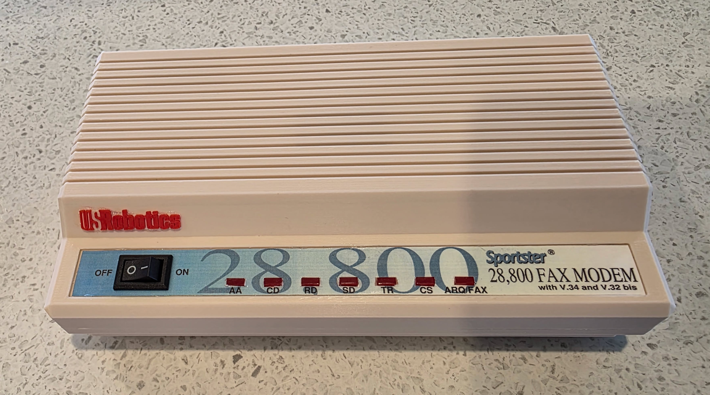
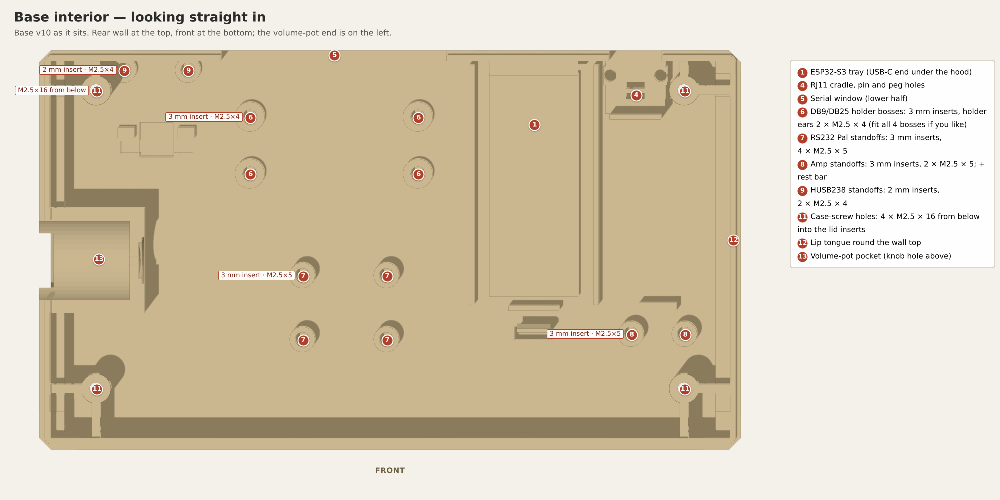
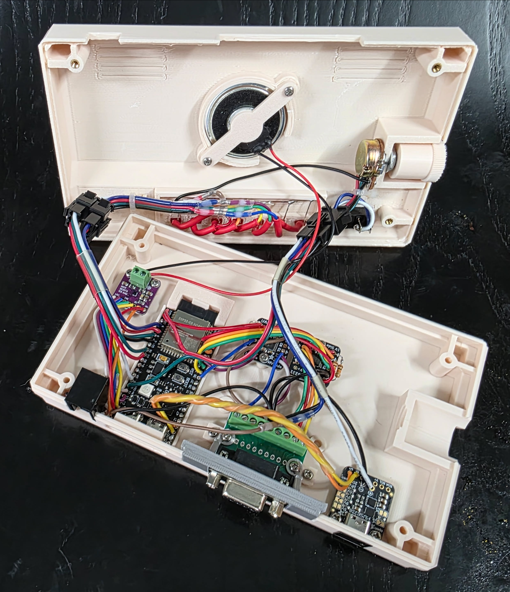

# USR Modem Emulator: Case

This folder holds the 3D-printed US Robotics Sportster replica that houses the modem: print projects, individual STL parts, front-label artwork, construction drawings and fastener notes. It covers the case steps of the [build guide](../README.md#follow-the-build): gathering the case parts, printing the case and label, mounting the parts and closing the case. The wiring is in [step 6 of the build guide](../README.md#6-wire-the-electronics) and the [electronics brief](../electronics/README.md).

## What is in this folder

| Path | What is present |
|---|---|
| [0.4mm Main Print.3mf](0.4mm%20Main%20Print.3mf) | Bambu Studio project for the enclosure and main fittings |
| [0.2mm Fine Parts.3mf](0.2mm%20Fine%20Parts.3mf) | Bambu Studio project for the knobs, logo and power trim |
| [`parts/`](parts/) | Individual STL models for other slicers |
| [`labels/`](labels/) | Front-label artwork for all four modem identities, as print-ready PDFs and PNGs |
| [`construction/`](construction/) | Inside plans of the base and lid, front and rear views, the extra-parts drawing, a combined fit-check drawing and the [fastener notes](construction/Screws%20and%20Inserts.txt) |

## Choose a DB9 or DB25 rear socket

| Rear socket | Why choose it? | How it is fitted |
|---|---|---|
| DB9 female | Convenient for modern use: USB-to-RS232 cables usually have a DB9 connector | Fit the DB9 terminal board and the printed insert around the socket |
| DB25 female | Matches the socket on the original Sportster modems | Mount the same DB9 terminal board farther inside the case using the alternate mounting holes, then attach the DB9-to-DB25 adapter |

**The wiring and firmware are identical for both versions.** Only the mounting position, opening insert and adapter differ. The current build photos all show the DB9 version.

## Materials

You will need cream or beige PLA for the enclosure and knob, red or black (as suits) for the logo, and black for the rear power trim. The supplied print projects also include a grey/silver DB9 insert option. A single-colour printer can make separate parts in separate print jobs.

Use M2.5 brass heat-set inserts: these are small threaded sleeves pressed into the plastic with a heated tool - a soldering iron with a fine point tip set to 220 °C works well. The measurements below are **insert lengths**, not hole diameters.

| Location | Inserts |
|---|---|
| Four lid corners | 4 × M2.5, 6 mm long |
| Speaker strap mounting holes in the lid | 2 × M2.5, 4 mm long |
| Base mounting points for the serial connector holder | 2 × M2.5, 3 mm long: the rear pair for DB9, the front pair for DB25; optionally fit all four positions |
| Two RS232 Pal modules | 4 × M2.5, 3 mm long |
| Amplifier | 2 × M2.5, 3 mm long |
| USB-C power board | 2 × M2.5, 2 mm long |
| Serial connector holder itself | 2 × M2.5, 3 mm long |

| Fixing | Screws |
|---|---|
| Base to lid | 4 × M2.5 × 16 mm, pan head |
| Speaker strap | 2 × M2.5 × 6 mm |
| DB9 terminal board to holder | 2 × M2.5 × 5 mm |
| Holder to base | 2 × M2.5 × 4 mm |
| Two RS232 Pals | 4 × M2.5 × 5 mm |
| Amplifier | 2 × M2.5 × 5 mm |
| USB-C power board | 2 × M2.5 × 4 mm |

These lengths come from the [construction drawings](construction/) and [fastener notes](construction/Screws%20and%20Inserts.txt). Check engagement with your actual inserts: a screw must hold the part without bottoming out or reaching the outside wall. Add four round **10 mm diameter × 5.75 mm** adhesive rubber feet for the base recesses.

For the label, use A4 self-adhesive paper or printable vinyl suitable for your printer, plus plain paper for a trial fit. A clear protective film is optional. You will also need a little suitable adhesive for decorative parts.

The electronic parts that mount in the case are listed in the [build guide's parts table](../README.md#electronics). For DB25 you also need the Assmann AB468 DB9 male to DB25 female adapter.

## Tools

- An FDM 3D printer, or a printing service, and slicer software. The supplied projects are for Bambu Studio; individual STL files are included for other slicers.
- A 0.4 mm nozzle for the main parts and, ideally, a 0.2 mm nozzle for the fine details.
- A heat-set insert tip or suitable heated insertion tool, small screwdrivers and a craft knife.
- A ruler and cutting mat for the label.

## Print the case and fittings

There are two prepared print projects:

| Project | Saved settings | Contents |
|---|---|---|
| [0.4mm Main Print.3mf](0.4mm%20Main%20Print.3mf) | Bambu P1S, PLA, 0.4 mm nozzle, 0.12 mm layers, 3 walls, 15% infill, automatic tree supports enabled | Enclosure, serial holder/inserts, speaker strap, ESP32 brace and USB blanks |
| [0.2mm Fine Parts.3mf](0.2mm%20Fine%20Parts.3mf) | Bambu P1S, PLA, 0.2 mm nozzle, 0.06 mm layers, 4 walls, 40% infill, supports disabled | Two knob styles, logo and black power trim |

Some small parts have their own settings, including solid infill. Keep those overrides when using the projects. Before printing, select your actual printer, nozzle, plate and filament profiles, then slice again and inspect the preview. These are saved settings for the supplied projects, rather than a guarantee for every printer.

If you use another slicer, import the individual models from [`parts/`](parts/) at **100% scale**, in millimetres. Start with the settings above and use the construction drawings to check orientation and mounting details. Test a small holder or knob before committing to the full case.

Print these parts for either version:

| Model in `parts/` | Purpose |
|---|---|
| `modem-base.stl` and `modem-lid.stl` | Main enclosure |
| `db9-holder-v3b-text.stl` | Holds the DB9 terminal board, including when it carries the DB25 adapter |
| `speaker-strap-bar.stl` | Retains the speaker in the lid |
| `s3-latch-brace.stl` | Retains the ESP32 in its tray; a `s3-latch-brace-v6.stl` alternative is also supplied for fit checking |
| `power-panel-black.stl` | Black trim around the rear USB-C socket |
| `usb-blank-full.stl` or `usb-blank-half.stl` | Covers both onboard USB sockets, or leaves one accessible |
| `voldial-hub-plus7.1-bore6.1-faceA.stl` or `voldial-hub-plus7.1-bore6.1-faceC.stl` | Choose one volume knob style; both have a nominal 6.1 mm bore |
| `usr-logo.stl` | Decorative front logo |

For a **DB9 rear socket**, also print `db9-insert-v4.stl` to fill the wider serial opening. For **DB25**, leave out that insert and use the DB9-to-DB25 adapter instead. The main print project contains alternative inserts; you only need the one you choose. The [extra-parts drawing](construction/extra-parts.png) explains the fittings, though some filenames in that drawing predate the current STLs.

Remove supports and loose strands carefully. Check the lid meets the base, the LEDs and switch fit their openings, the knob fits its shaft, and the boards sit in their mounts. Correct the fit before installing inserts or soldering. Keep the original scale: resizing the enclosure also moves its mounting holes and connector openings.

If you need to modify the case and you aren't familiar with 3D modelling software, an AI assistant can help: that is how luizpacheco's design was modified for this build.

## Print and fit the front label

The label folder contains designs for all four modem identities. Choose the appearance you prefer; you will set the firmware to match with `AT*MODEL` when you [join Wi-Fi and open the browser interface](../README.md#8-join-wi-fi-and-open-the-browser-interface).

1. Open [USRobotics_All_Speeds_A4_STL_Print.pdf](labels/USRobotics_All_Speeds_A4_STL_Print.pdf). This sheet aligns the switch and LED cutouts to the printed case and includes two copies of each design.
2. Print a paper test on A4 at **100% / Actual size**. Turn off “Fit to page” and similar scaling options.
3. Measure the **100 mm scale-check line** at the bottom of the sheet. It should measure 100 mm. Cut out your chosen label and hold it against the case, checking the switch opening and all seven LED positions.
4. Once the paper test fits, print on your chosen adhesive stock. Let the ink or toner settle as required by that material. You may wish to laminate the label for extra protection.
5. Cut the outside edge with a craft knife using a ruler as a straight edge.
6. Clean the front recess, let it dry, and apply the label gradually from one end. Smooth it down without stretching it. It is easier to do this while the lid is empty.
7. Once the adhesive is dry, cut the switch/LED openings with a sharp knife on a cutting mat. The switch and LED holes make the cutting easier.

The [label folder](labels/) also contains an STL-aligned PNG of each model's label and of the whole A4 sheet, at 2400 dpi. Prefer the STL-aligned PDF for this enclosure: image editors and printer software can interpret PNG scale differently.

## Prepare the case and mount the parts

Use the [base plan](construction/base-inside-plan.png) and [lid plan](construction/lid-inside-plan.png) to identify each mount. Each drawing looks into that half of the enclosure, so left and right change when you turn the lid over. The [fit-check drawing](construction/final-case-check.png) shows both DB9 holder positions.

1. Fit the heat-set inserts before mounting electronics. Use the insert and filament suppliers' temperature guidance, press each insert squarely into its hole, and stop at the intended surface. Let it cool before fitting a screw. Support the plastic around the hole and avoid pushing through the thin case wall.
2. Position the ESP32 in its tray with its USB sockets facing the rear opening. Check the chosen latch brace holds it without bending the board. Leave the **Console USB / UART** socket accessible for programming.
3. Mount the two RS232 Pals, amplifier and USB-C power board at the positions shown in the drawing. Check that solder joints cannot touch neighbouring hardware.
4. Fit the DB9 terminal board to its printed holder. For **DB9**, use the mounting points that bring its socket to the rear opening, and fit the printed DB9 insert around it. For **DB25**, mount the same board farther inside the case using the alternate mounting holes, then plug the AB468 DB9-to-DB25 adapter into it. The adapter's DB25 socket sits at the rear opening. Check connector alignment with the lid in place before tightening. No wiring or firmware changes are needed.
5. Seat the speaker in the lid pocket and retain it with the strap and two M2.5 × 6 mm screws. The strap bears lightly on the magnet; avoid overtightening or touching the speaker cone. If you are concerned about speaker movement, consider applying a small piece of double-sided tape to the centre part of the speaker strap.
6. Fit the volume pot and chosen knob. The knob should turn freely throughout the pot's travel without rubbing the case. Fit the switch and seven LEDs through the labelled front panel, noting each LED's polarity before trimming its legs.
7. Fit the rear power trim. Leave the USB blank removable so you can reach the maintenance socket later. Any RJ11 telephone socket fitted for appearance stays unwired.

The boards may need to come out again for soldering. At this stage, the aim is to establish the fit and wire lengths. Leave enough slack between base and lid to open the case for maintenance.

All current build photos, including the [rear view](../screenshots/Back.jpeg), show the **DB9 version**. Use them as placement examples and follow the mounting instructions above if you choose DB25. The [wiring tables](../README.md#6-wire-the-electronics) apply to both versions.

## Close the case

Once the electronics and a real serial connection work, disconnect all power and close the enclosure. Route wires away from the antenna, speaker cone, screw holes and lid seam. Check that the knob and switch move freely, then fit the four M2.5 × 16 mm screws from underneath into the lid inserts. Fit the USB blank and four rubber feet, and attach the printed logo if you have not already done so.

## Credits and licence

This wouldn't have been possible without the excellent RetroExternalModem design by luizpacheco on Thingiverse: https://www.thingiverse.com/thing:7063155. The case models, print projects and label artwork are adapted from that design and keep its non-commercial terms; see [CREDITS.md](../CREDITS.md) before redistributing them or using them commercially.
